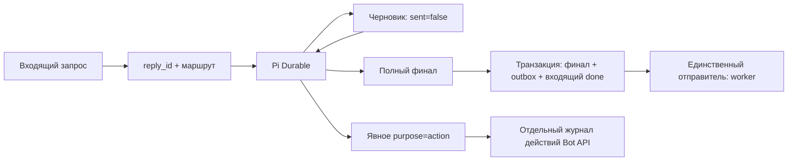

# Протокол разговорного ответа v1

Статус: реализован. Источник содержания — полный финал Pi, а не первое сообщение инструмента.

## Инварианты

1. Один входящий запрос имеет один `reply_id = hash(scope, request_id)` и один неизменяемый финал.
2. До завершения хода никакой черновик разговорного ответа не вызывает Telegram.
3. После завершения хода выбирается весь финальный текст, включая отличающиеся формулировки и дополнения. Черновик его не блокирует и не заменяет.
4. Финал, план доставки и завершение входящего события записываются одной транзакцией. После сбоя существуют либо все три, либо ни одного.
5. Доставкой разговорного ответа занимается только outbox worker. Для каждой части существует один устойчивый ID и атомарный переход `pending → sending`.
6. Самостоятельные Telegram-действия имеют явный `purpose=action`, собственные ID и квитанции. Они не считаются разговорным ответом и не подавляют финал.

## Контракт инструментов

`telegram_api` сохраняет полный доступ к Bot API. Для текстовых методов `sendMessage`/`sendRichMessage` по умолчанию выбран `purpose=reply`; для остальных методов — `action`.

В режиме `reply` можно предложить черновик plain-text `sendMessage` в текущий чат и исходную тему. Черновик хранится в `reply_drafts`; квитанция явно содержит `delivery=draft`, `sent=false` и не содержит `message_id`. Важные сведения должны находиться в финале. После черновика пустой финал — нарушение контракта, а не неявная команда опубликовать черновик.

Маршрут ответа задаёт приложение. Фрейм ответа находится в метаданных принятого входа Pi; инструмент находит его по `LiveDoc.run.first`, проверяет единственный вход `run.inputs` и сохраняет привязку в memo своего durable task. Роль сообщения, похожие тексты и mutable «последнее сообщение чата» для корреляции не используются. Один разговор Pi исполняет запросы последовательно.

`purpose=action` означает буквальный самостоятельный API-вызов со всеми параметрами: например, публикацию в другом чате, два отдельно запрошенных сообщения, rich HTML, точные entities или клавиатуру. Действие возвращает настоящий результат Telegram. Этот режим не нужен для обычного разговорного ответа. Независимые действия и разговорный ответ могут сосуществовать; запретить совпадающие тексты таких разных намерений без семантических догадок невозможно и протокол этого не делает.

## Фиксация и восстановление

`reply_turns` хранит идентичность, маршрут и полный финал; `reply_drafts` — предложения инструментов; `reply_parts` связывает последовательные части финала с outbox. Коммит не меняется при повторе. Иное содержимое для уже зафиксированного `reply_id` — явный `FINAL_REPLY_IMMUTABLE`, а не молчаливая подмена.

Фрагменты до 4000 UTF-16 единиц сохраняют весь текст и пары суррогатов. Часть N отправляется только после подтверждённой доставки всех предыдущих. Это один разговорный ответ с детерминированными частями, а не независимые повторные ответы.

Состояния внешней отправки: `pending → sending → sent | rejected | unknown`. После падения `sending` становится `unknown`; автоматического повторного POST нет. У [Bot API sendMessage](https://core.telegram.org/bots/api#sendmessage) нет документированного клиентского ключа идемпотентности. Поэтому обещать одновременно обязательную доставку и exactly-once при потере подтверждения нельзя. Протокол выбирает отсутствие автоматического дубля: финал остаётся сохранённым, неизвестный результат требует сверки.

## Переход с v0

Это отдельный адаптер восстановления, не штатный алгоритм выбора ответа:

- Старые подготовленные `answer:<update_id>` / `failure:<update_id>` привязываются к `reply_id` по ID производителя и входящего события до запуска worker. Повторное вычисление и вторая очередь не создаются.
- Уже принятый вход без метаданных v1 распознаётся по версии протокола. Из его durable квитанций можно восстановить известный ID старого сообщения. Новый полный финал редактирует это сообщение; его содержание не выбрасывается.
- Неизвестная старая доставка или несколько неоднозначных старых сообщений блокируют автоматическую отправку. Полный финал сохраняется для сверки; произвольный выбор сообщения не производится.
- Завершённые разговоры и вся старая история не переносятся.

## Проверки

Контракт проверяется на разных черновике и финале, параллельных входах одного чата, перезапуске до и после commit, отказе вставки outbox, длинных ответах, атомарном захвате отправки, неизвестном POST, самостоятельных действиях и восстановлении настоящего v0-транскрипта официального Pi Durable. Проверки не отправляют тестовые сообщения в рабочие чаты.
