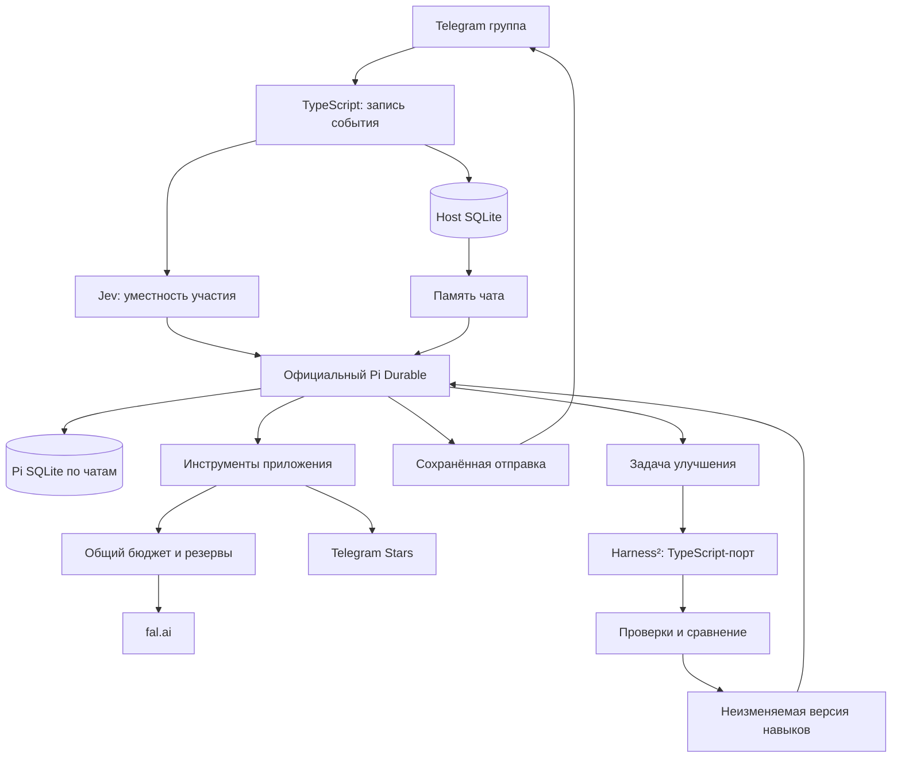

# Новый разговорный бот: решение и текущее состояние

Актуализировано 6 ноября 2026 года после уточнений: весь новый продукт пишется на **TypeScript и официальном Pi/Pi Durable**, включая порт алгоритма Harness². Jev определяет момент участия; память и динамические навыки сохраняются. Прежние Space/Dream, PHP и Temporal в новое приложение не переносятся.

Начальная реализация находится в `bot-next/`. 10 ноября настроен локальный запуск `deepseek/deepseek-v4.1-flash` и `typesafe/jev-1.14` через OpenRouter. Изолированная проверка обоих API прошла; токен и конфигурация хранятся в игнорируемом `.env`. Чаты подключаются автоматически с отдельными диалогом Pi, памятью и навыками. Миграция production-данных, настоящие Stars-платежи и fal-генерации не запускались. Инструкции — в [README](/Users/shanginn/Projects/wtf_happend_bot/bot-next/README.md).

## Что показал анализ старого проекта

Локальная основа — `f528c21`: PHP, PiPH, Temporal, PostgreSQL и TrueAsync. Telegram updates сохраняются, объединяются и передаются attention-router; он выбирает ответ, применение навыка или молчание. Версии поведения и памяти фиксируются на запуск.

| Наблюдение по коду | Вывод |
| --- | --- |
| Dream реализован, но штатный `SPACE_DREAM_ENABLED=false` | Наличие кода саморазвития не означает работающую функцию |
| Команды Space вызывают модель без tools; исполняемые capsules запрещены | Нужны реальные инструменты и исполняемые динамические навыки |
| Публикация требует точного имени и явной цитаты распоряжения администратора | Для автономного бота нужен самостоятельный цикл создания и испытания навыков |
| Поиск памяти ограничивает выборку последними 100 записями до текстовой фильтрации | Поиск должен охватывать весь допустимый набор знаний |
| Изображения представлены текстовыми метаданными | Понимание фото требует передачи визуального содержимого подходящей модели |
| Реакции отбрасываются; платежи отключены | Обратную связь и Stars надо интегрировать заново |

Опоры: [Dream default](/Users/shanginn/Projects/wtf_happend_bot/config/temporal.php:51), [команды без tools](/Users/shanginn/Projects/wtf_happend_bot/src/Space/Command/SpaceCommandActivity.php:37), [публикация поведения](/Users/shanginn/Projects/wtf_happend_bot/src/Space/Runtime/SpacePrompt.php:142), [поиск памяти](/Users/shanginn/Projects/wtf_happend_bot/src/Space/Tools/SpaceMemoryToolStore.php:55), [обработчик updates](/Users/shanginn/Projects/wtf_happend_bot/src/Space/Workflow/SpaceAgentWorkflowHandler.php:19). Это исходники, а не измерение production-конфигурации или качества диалогов.

Буквальный `HEAD~1` почти не меняет поведение: последний commit добавил проверку доступа. Содержательно полезны три поколения:

| Опорная версия | Что сохранить как продуктовую идею |
| --- | --- |
| `96927fc`, до PiPH | Хороший `/wtf`, выделение тем и решений, визуальный контекст, компактная память разговора |
| `7ce2e1c`, 8 августа | Прямой агентный цикл и создание/использование навыков без тяжёлой платформы |
| Space/Dream, с `9f55b8e`, 12 августа | Изоляция чатов, происхождение знаний, неизменяемые версии и восстановление после сбоев |

Введение Space/Dream затронуло 194 файла и добавило около 26 тысяч строк. Это показывает сложность сопровождения, но не доказывает ухудшение разговоров. Выбран новый небольшой проект, а не откат на предыдущий commit.

## Принятая архитектура

Официальные `@earendil-works/pi-ai`, `pi-durable`, `chord`, `pi-schema` и `pi-codemode` закреплены на **1.5.0**. Исследованные сторонние Python-порты больше не являются архитектурным выбором. Второй workflow engine, отдельная векторная БД и универсальная система плагинов не добавлены. [Pi Durable](https://github.com/earendil-works/pi/blob/main/packages/durable/README.md).

Host SQLite хранит входящие события, решения Jev, исходящие операции, проводки, факты и артефакты навыков. Отдельные Pi SQLite-файлы хранят агентные разговоры и checkpoints. PostgreSQL используется только для чтения старой истории. Один процесс владеет каталогом состояния; массовое горизонтальное масштабирование пока не реализовано.

## Jev и разговор

Jev вызывается через TypeSafe API, фиксированный `jev-1.14.0`. Реализованы четыре оценки Noul: обращение к боту, продолжение разговора с ним, полезность инициативы и навязчивость. Решение принимает короткая функция с отдельными порогами; спонтанные ответы ограничены интервалом. При сбое действует резервное правило явного обращения. Решение и версия модели сохраняются для повторной обработки события. [Noul](https://docs.typesafe.ai/primitives/noul), [модели](https://docs.typesafe.ai/models).

Пороговые значения пока исходные, не откалиброваны на реальном русскоязычном чате. Нужны одинаковые эпизоды для сравнения с простым правилом mention/reply: лишние вмешательства и пропущенные обращения измеряются отдельно. Платежи и права не решаются через LLM.

Разговорный Pi получает характер группы, авторов и контекст; инструменты позволяют обратиться к памяти, запросить генерацию, предложить поддержку и поставить задачу улучшения. Молчание не означает потерю принятого события. Отдельное фоновое извлечение фактов при молчании пока не реализовано: сейчас факт сохраняется через инструмент Pi или миграцию.

Фотография загружается приложением и может передаваться выбранной модели как изображение. Нужна совместимая модель и реальные испытания качества. Текущая Telegram-интеграция обслуживает группу; broadcast-канал с `channel_post` пока не подключён.

## Память и миграция

Реализованы scoped-факты с субъектом, источниками, цитатами и датами; лексический поиск по всему чату, дедупликация и забывание с запретом повторного извлечения. Семантический поиск, эмбеддинги, автоматическое объединение всех противоречий и полноценная эпизодическая память пока остаются развитием.

`forget` удаляет активное содержание, блокирует соответствующий текст и источники и не должен ждать цикла саморазвития. Обычные явные исправления и запоминания тоже не требуют сравнительного benchmark. Сохранённые transcript, архивы миграции и резервные копии имеют отдельный жизненный цикл: compaction не является удалением первичных записей.

Путь миграции уже реализован:

1. Read-only inventory старого PostgreSQL.
2. Экспорт `update_records` и ранних `messages` в ограниченный JSONL с правами `0600`.
3. Нормализация chat/user/message IDs, дат и правок; объединение дублей.
4. Сопоставление forgotten memory по ревизиям, provenance и цитатам до извлечения знаний.
5. Фиксация manifest: хеш источника, cutoff, scope, версии экстрактора/политики, chunks и бюджет.
6. Извлечение кандидатов с точными цитатами, сохранение результатов и checkpoint.
7. Атомарный идемпотентный `apply` только знаний в новую память.

CLI: `inventory`, `export`, `prepare`/`knowledge`, `resume`, `status`, `review`, `apply`. `knowledge --dry-run` не пишет активную память, но расходует ограниченный бюджет модели; `review` показывает извлечённые факты с исходными цитатами перед применением. Изменившийся архив или модель не подставляются в существующий run. Неизвестный результат платного вызова удерживает резерв; завершённые chunks не вызываются заново. Сверка доступна через API `reconcileChunk`; отдельной CLI-команды для неё пока нет.

Экспорт не меняет исходную БД; использует `REPEATABLE READ READ ONLY`, проверяет реальные колонки схемы и завершается `ROLLBACK`. Нельзя утверждать полноту архива до inventory. Учитываются старые привязки тем того же чата и выбранного `BOT_INSTANCE_ID`; если привязки есть только у другого экземпляра или forgotten-запись нельзя надёжно сопоставить с источником, экспорт останавливается. Поддержаны сообщения и подписи из известных таблиц `public`; отдельные bot outputs из `tool_execution_records`/`llm_provider_responses`, отсутствующие сообщения и расшифровки медиа не восстанавливаются. В новую память не копируются полная переписка, provider payloads, reasoning, Space releases или старые исполняемые инструкции. Частный JSONL — промежуточный архив, а не рабочая база нового бота.

## Саморазвитие через Harness²

Используемый цикл [Harness²](https://github.com/google-research/harness2) перенесён с commit `6868817518876de8fd170c6a8354daca273b6191` на TypeScript: построение кандидатов, испытания, композиция, анонимный выбор и рефлексия. Код выполняется непосредственно в Node.js; отдельный интерпретатор и процесс-мост удалены. Сохранены лицензия Apache-2.0, атрибуция и происхождение исходников. Это адаптированный локальный порт для Pi, а не неизменённый upstream или официальный TypeScript-пакет Google. Порядок и зависимости этапов проверяются по сохранённым эталонам оригинала; подсказки адаптированы к JS/TS-навыкам чатового бота.

Бот создаёт или меняет `AGENTS.md`, `.agents/skills/<name>/SKILL.md` и небольшие JS/TS-скрипты. Скрипты запускаются в QuickJS через официальный Pi Code Mode, получают JSON и возвращают JSON. Сейчас нет сети, файлов хоста или произвольных npm-пакетов. Реальные действия выполняют инструменты приложения, чьи ключи и финансовые ограничения не входят в изменяемый артефакт.

Модель может самостоятельно поставить `improve_skills`; автоматический цикл включён после каждых 50 пользовательских событий, прошедших Jev, не чаще раза в 24 часа на чат. Молчаливые решения учитываются; служебные команды и пауза — нет. `/learn` — дополнительная команда владельца. Испытание использует симулированные инструменты; версия включается автоматически после контрактных тестов и отдельного сравнения. Артефакты адресуются хешем, ранее разрешённые чатовые версии сохраняются для незавершённой работы.

Текущая независимая оценка мала и использует модель. Пока не доказаны устойчивое улучшение на реальных разговорах, независимость от переобучения на фиксированных примерах и автоматический откат по production-регрессиям. Это следующий проверяемый результат, а не уже достигнутое свойство. Результаты исследовательских benchmark Harness² сами по себе не доказывают улучшение юмора и уместности в группе.

## Stars, расходы и fal.ai

Реализованы счета `XTR`, проверка pre-checkout, идемпотентное зачисление `successful_payment` и учёт возврата. Бот может предложить добровольное пополнение через свой инструмент с cooldown. Платёж не даёт полномочий администратора и не становится персональным балансом. [Telegram Stars](https://core.telegram.org/bots/payments-stars).

Денежные состояния разделены: поступления Stars по чатам и **общий** USD-лимит AI-операций. Stars напрямую в fal не тратятся. Счета провайдеров предварительно финансирует владелец. `BOT_BUDGET_USD` задаёт начальный лимит только для пустого ledger; последующие пополнения выполняются отдельной host-командой. Резервы учитывают параллельные операции и неизвестные исходы.

fal сейчас подключён как один настроенный text-to-image endpoint с ограничением цены, сохранением provider request ID и polling очереди. Редактирование картинок, видео, набор моделей и подписанные webhooks ещё не реализованы. Цена из настройки — консервативный учётный потолок, не подтверждённая фактическая сумма счёта fal. Нужны реальная проверка endpoint и сверка расходов. [Очередь fal](https://fal.ai/docs/documentation/model-apis/inference/queue).

Если fal принял submit, но ответ с request ID потерян, платный submit автоматически не повторяется. Аналогично потерянное подтверждение Telegram send не доказывает, что сообщение не отправлено. Внутренний ledger не создаёт exactly-once у внешнего API.

## Что проверено и что ещё требуется

Локальные тесты покрывают финансовые резервы, повтор платежа, сохранение операций, память, миграционные checkpoints, нормализацию старых сообщений и восстановление Pi. Harness² тестируется как TypeScript-порт с подставными модельными вызовами и эталонами исходного алгоритма. Это не платный live experiment и не проверка реальных ключей провайдеров.

До эксплуатации нужны: реальное тестовое общение, калибровка Jev, проверка выбранной vision-модели, тестовые Stars/fal сценарии, read-only inventory живой старой БД, оценка кандидатов памяти, проверка backup/restore и план переключения единственного poller.

Host SQLite использует `FULL`; Pi backend штатно WAL/`NORMAL`, поэтому процессный restart не равен полной защите от потери хоста. Для восстановления обеих частей состояния нужна сверка стабильных IDs и неизвестных внешних операций. Production deployment, распределённый failover и полный операторский интерфейс сверки пока отсутствуют.
